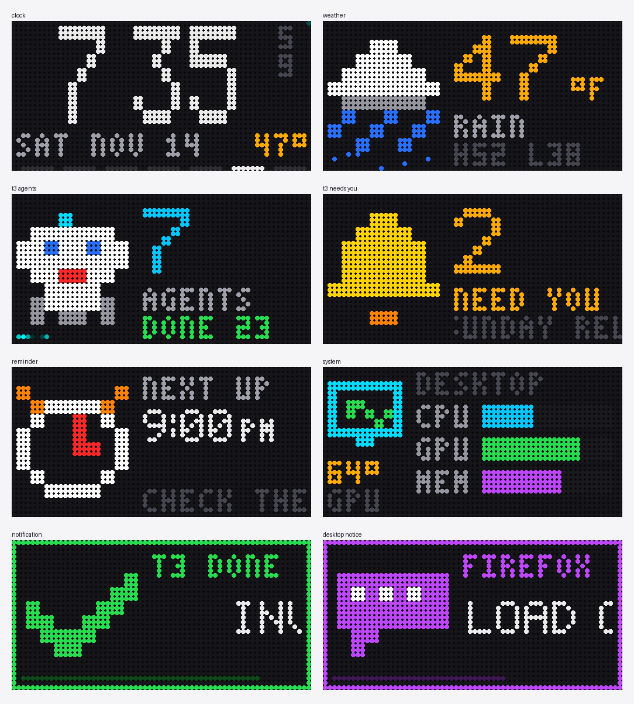

# Pixel clock

A pixel-art desk clock in the style of the Ulanzi-type clocks: an icon on the left, a big number on the right. It runs on the parts marked in use in this inventory:

- Raspberry Pi 4 Model B
- Adafruit RGB Matrix HAT + RTC
- P3 RGB LED matrix panel, 64x32 (HUB75)



## Screens

| Screen | What it shows |
|---|---|
| Clock | Big time with a blinking colon, seconds, the date, the outdoor temperature, a weekday bar. The top-right pixel pulses cyan while T3 agents work and blinks amber when a thread needs you. |
| Weather | Condition icon, temperature, high and low (Open-Meteo, refreshed every 15 minutes, no API key). Rain and snow fall under the icon. |
| T3 agents | How many agent runs are going, and how many of your threads finished today. |
| T3 needs you | Replaces the agents screen when a thread is waiting on an approval or question, with the thread title scrolling. |
| Next up | The next Grokbot reminder. |
| Desktop | CPU, GPU and memory load and GPU temperature on the workstation. |
| Pop-ups | Slide in over any screen: T3 thread finished (green), failed (red), needs you (amber), and every desktop notification (purple). |

Screens without fresh data are skipped. The panel dims from 10 PM to 7 AM.

## How it fits together

```
workstation                                   Raspberry Pi (pixelclock.local)
  bridge/pixel_bridge.py  --HTTP, token-->      pixelclock/app.py  --> RGB matrix
    T3 state DB (read-only)                       weather from Open-Meteo
    desktop notifications (D-Bus)                 http://pixelclock.local:8765/ live preview
    nvidia-smi, /proc, grokbot-remind
```

### Pi API (port 8765)

- `GET /` live preview page; `GET /frame.png` the current frame; `GET /state`
- `POST /notify` with header `X-Token` and JSON `{"icon": "bell", "title": "Hi", "text": "Scrolling text", "color": [255,170,0]}`
- `POST /state` with header `X-Token` merges keys (`weather`, `t3`, `system`, `reminder`, `brightness`)

Icons: robot, bell, check, cross, sun, moon, cloud, partly, rain, snow, storm, fog, chat, chip, merge, alarm, heart, zzz, mail, cpu.

Send one from a shell:

```sh
curl -s -H "X-Token: $(cat ~/.config/pixelclock/token)" -d '{"icon":"heart","title":"Hello","text":"From the desk"}' http://pixelclock.local:8765/notify
```

## Setting up a Pi from scratch

1. Download Raspberry Pi OS Lite 64-bit (Trixie) and attach it: `udisksctl loop-setup -f image.img` mounts `bootfs`.
2. `PIXELCLOCK_TOKEN="$(cat ~/.config/pixelclock/token)" tools/prepare_boot.sh /run/media/$USER/bootfs <wifi-connection> ~/.ssh/<key>.pub`
   It writes cloud-init files (hostname `pixelclock`, user `pi` with key-only SSH, Wi-Fi from this machine's NetworkManager profile), turns off onboard audio, reserves CPU core 3 for the matrix and copies this folder onto the card.
3. Write the image to a microSD card or USB stick and boot the Pi. On first boot `pi/setup.sh` installs the matrix library and starts `pixelclock.service`.

On the workstation the bridge runs as a user service:

```sh
cp bridge/pixel_bridge.py ~/.local/share/pixelclock/
cp bridge/pixel-bridge.service ~/.config/systemd/user/
systemctl --user enable --now pixel-bridge
```

## Preview without the hardware

```sh
python3 tools/preview.py preview.png
python3 -m pixelclock.app --backend null --config test.json   # then open http://localhost:8765/
```

## Panel settings

`/etc/pixelclock.json` on the Pi overrides the defaults in `pixelclock/app.py`: `hardware_mapping` (`adafruit-hat`, or `adafruit-hat-pwm` if the HAT's PWM jumper is soldered), `gpio_slowdown`, brightness, night hours, `hour24`, `units`, `latitude` and `longitude`, `led_rgb_sequence` if colors come out swapped, and the screen rotation.
